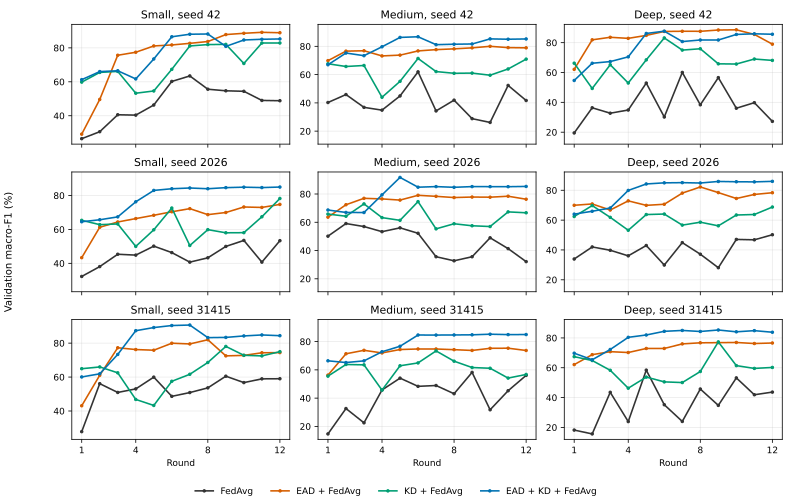
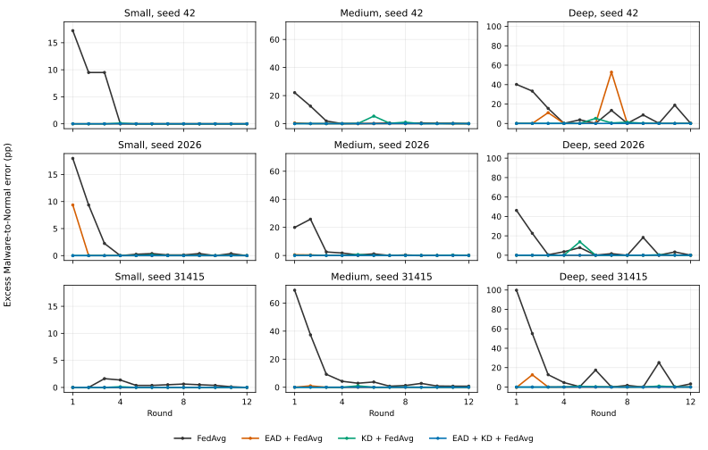

# EAD–DC–FL: consolidated development evidence and viva brief


## Within-FL KD controls complete, verified 28 October 2026

All three requested archives are received and verified. The main 36-run study is
unchanged; 12 additional controls across seeds 42, 2026 and 31415 separate master
warm-start from recurring adaptive KD. There are now 48 verified completed 12-round
FL runs, with six central-only fits counted separately. Earlier pilots/tests/replays
are excluded. The schedule comparison reuses six original full-KD references.

Both original full KD and warm-start-only match their policy-matched benign
committed targeted-error rates at all 108 seed/architecture/round observations per
policy. Recurring KD after round 3 is not required to reproduce this specific result
in these three evaluated configurations. EAD, FedAvg, master warm-start and local
training remain; master-only sufficiency is not established. Absolute errors remain,
and zero excess in one target transition is not absence of all poisoning effects.

Adaptive-only worst positive excess TMR is 52.81 pp in seed 42, 0.50 pp in seed 2026
and 0.37 pp in seed 31415. Master teaching cannot be claimed universally necessary.
KD both worsens targeted behaviour under accepted accuracy/macro-F1 gains and
repairs targeted errors in other recorded steps. Teacher selection and recipient
self-skipping materially affect interpretation. Counts do not identify per-example
transfer or the sole cause of every seed difference.

Full-KD attacked endpoint macro-F1 means are 83.80/86.19/84.13% for Small/Medium/Deep,
versus warm-start-only 82.86/83.87/83.70% and adaptive-only 76.84/79.03/80.44%.
Paired full-minus-warm effects vary by seed: mean effects are +0.94/+2.32/+0.43 pp,
with sample SD 3.65/2.01/1.33 pp. These descriptive three-run results do not establish
statistical significance or universal utility gains. Runs, not clients, architectures
or rounds, are the replication unit, conditional on fixed data/master/attacker IDs.

The bounded schedule-control programme is complete. Preserve the original main
method and the two identifiable ablations; stop adding schedule variants to this
block. Consolidated source checks, tables, trade-offs and Chapter 4/5 implications:
[kd_schedule_three_seed_results.md](kd_schedule_three_seed_results.md). The 12
controls record 7.68 hours, excluding inherited master pre-training and reused
references. Final test remains untouched; final protocol remains unfrozen. Data
provenance, validation reuse, broader heterogeneity/threats, proxy dependence and
fuller costs remain limitations or separately prioritised evaluation work.


**Additional evidence,28October2026:** the fixed-master replay and six seed42central-only reference fits are complete. Their validation accuracy is64–68%, compared with about86%for the matched benign combined FL run. All central references already have99.50%Malware recall and2/801Malware-to-Normal errors. These tested central-only procedures do not reproduce overall FL utility, while trusted server supervision remains a plausible contributor to targeted protection. The controls are unpoisoned, one-seed and not compute-matched; they do not isolate the master contribution within FL. See [server_supervision_seed42_results.md](server_supervision_seed42_results.md). The main matched FL count remains36.


Evidence reviewed on27October2026. The main development package contains36completed12round runs: three training seeds × four component conditions × three scenarios (benign, Gaussian poisoning and targeted label flipping). The12benign runs are shared controls for both attack families. Earlier four-round pilots, fidelity checks and methodological variants are additional diagnostics, excluded from this count.

## What was implemented and verified

The working pipeline is local client training, optional EAD screening within architecture groups, survivor-renormalised sample-weighted FedAvg, optional server-side KD, and commitment or rollback under the specified KD policy. Small, Medium and Deep are fixed architecture groups, ten clients each. All30clients participate in every round. This instantiates model heterogeneity; the integration batch does not vary statistical heterogeneity or participation heterogeneity, and has no homogeneous-architecture counterfactual.

Four conditions are FedAvg, EAD/FedAvg, KD/FedAvg and EAD/KD/FedAvg. Within each seed they share initial weights, allocated data, normalisation, master checkpoint, training budgets, actual cohorts and minibatch order hashes. Method-dependent rejection and later model states may differ. Across seeds42,2026,31415, initialisation/training/noise/EAD randomness varies, while the data split, server master and compromised identities remain fixed.

Working EAD is the explicitly identified three-detector predict configuration: LOF, Isolation Forest and KNN with strict unanimous voting, predict/decision_function on the fitted cohort, and count-disagreement calibration reset from0.20 to0.30 in each triggered group-round. This is distinct from earlier fitted-label pilots and cannot be presented as a verified byte-identical reproduction of the original paper experiments.

Original KD uses the fixed pre-trained master unconditionally during rounds1–3. Later it selects the highest validation-accuracy cluster teacher, skips self-distillation and accepts candidate accuracy>=pre-KD accuracy. Guarded warm-start remains a separate four-round diagnostic variant, absent from the36run main comparison. KD uses30,048 server examples. Master supervision is a material part of this treatment and has not been isolated by equivalent central-supervision controls.

Verified from the archives and source:
- All36reports completed ordered rounds1–12. All expected conditions and all three matching manifests are present.
- Canonical manifest IDs recomputed. Within-seed report fingerprints, actual participants and training-order hashes agree; initial tensors and registered runner hashes agree with each manifest.
- Survivor counts and sample-weighted coefficients, upload attack flags, screening confusion sets, strict-vote outputs, calibration triggers, KD acceptance decisions and committed validation metrics are internally consistent.
- Targeted reports record1497poisoned training rows per round: Small500, Medium499, Deep498. Exactly nine compromised clients are active, three per group. Their saved Malware labels are changed to Normal before local training. Other local labels, server/evaluation labels and feature inputs are preserved by the inspected code. No Gaussian noise is added in targeted runs.
- The targeted protocol's inherited training_performed=false field describes its saved definition. Its scope_note explicitly distinguishes that definition from completed execution and upload_diagnostics. It does not mean the completed runs omitted local training.
- These checks inspect JSON, registered hashes and source. The result archives do not contain the underlying data, poison-row arrays or checkpoint tensors for an independent reload.
- Every report records test_evaluated=false and final_protocol_frozen=false. Data preprocessing provenance remains unresolved.

The standalone [analysis script](../scripts/summarise_development_archives.py) reproduces the core report checks and exports. Its CSV summaries were cross-checked against a separately calculated analysis. Creating the analysis script and documentation does not modify manifest-bound training source.

## Endpoint utility

Entries are validation macro-F1 mean ± sample standard deviation across three runs, in percent/percentage points. They are descriptive summaries, not confidence intervals. Clients, architectures and rounds are not independent replications. Each condition has three run-level replications, conditional on the fixed partition/master/compromised set.

| Scenario | Method | Small | Medium | Deep |
|---|---|---|---|---|
| benign | FedAvg | 80.81 ± 7.30 | 78.85 ± 4.67 | 80.90 ± 6.04 |
| benign | EAD + FedAvg | 79.41 ± 8.02 | 76.28 ± 1.37 | 80.66 ± 5.66 |
| benign | KD + FedAvg | 84.56 ± 1.27 | 85.29 ± 0.15 | 84.96 ± 1.13 |
| benign | EAD + KD + FedAvg | 83.90 ± 2.29 | 86.51 ± 2.33 | 83.90 ± 1.24 |
| gaussian | FedAvg | 53.73 ± 5.09 | 43.32 ± 12.06 | 40.38 ± 11.83 |
| gaussian | EAD + FedAvg | 79.36 ± 8.28 | 76.32 ± 2.62 | 77.98 ± 1.25 |
| gaussian | KD + FedAvg | 78.70 ± 3.98 | 64.81 ± 7.29 | 65.70 ± 4.77 |
| gaussian | EAD + KD + FedAvg | 84.88 ± 0.45 | 85.19 ± 0.18 | 85.15 ± 1.17 |
| targeted | FedAvg | 82.13 ± 7.28 | 78.29 ± 2.37 | 81.24 ± 5.82 |
| targeted | EAD + FedAvg | 79.36 ± 8.29 | 76.47 ± 2.71 | 80.26 ± 5.34 |
| targeted | KD + FedAvg | 84.63 ± 0.20 | 87.86 ± 4.28 | 85.07 ± 0.85 |
| targeted | EAD + KD + FedAvg | 83.80 ± 2.03 | 86.19 ± 2.52 | 84.13 ± 1.42 |

All accuracy results, per-run outcomes and descriptive uncertainty are in [mean_sample_sd.csv](evidence/development_20261027/mean_sample_sd.csv) and [run_metrics.csv](evidence/development_20261027/run_metrics.csv).

Gaussian interpretation: the combined method has the highest mean final macro-F1 among these four conditions for every architecture. This does not imply superiority in accuracy, every seed or every round. Small's KD benefit changes sign between seed42 and the other two seeds. The Gaussian perturbations are conspicuous, with recorded noise/model norm ratios about2.86–7.29 in screened runs. This is not a stealthy/adaptive-threat evaluation.

Targeted interpretation: KD-only has higher mean final macro-F1 than the combined method for all architectures. The combined method provides a stronger observed targeted-error result over the trajectory, described below. Final utility and transient security therefore support different rankings. Do not claim universal superiority of the combined method.



Figure1. Validation macro-F1 under Gaussian sigma0.5 for each seed and architecture. Each line is one matched method trajectory. Y-axis scales are shared within architecture columns. The fixed12round endpoint is retained; no best-round selection is used. Oscillations, especially in seed42, prevent an unqualified convergence claim.

## Screening: threat dependence and benign rejection

| Threat | Screening condition | TP | FN | FP | TN | Detection recall |
|---|---|---|---|---|---|---|
| Gaussian | EAD, KD off | 324 | 0 | 0 | 756 | 100% |
| Gaussian | EAD, KD on | 324 | 0 | 0 | 756 | 100% |
| Label flipping | EAD, KD off | 293 | 31 | 0 | 756 | 90.43% |
| Label flipping | EAD, KD on | 287 | 37 | 3 | 753 | 88.58% |

These counts pool repeated client-round submissions across three runs. They do not create324independent experimental replications. Differences in later screening between KD-off and KD-on runs occur on different model trajectories. KD is applied after current-round screening; these comparisons do not mean KD directly changes an already-made current-round decision.

Clean controls reject136/1080benign submissions (12.59%) with EAD-only and120/1080 (11.11%) with EAD/KD. These are client-screening false positives, distinct from IDS false alarms. Benign suppression remains a limitation under IID allocations; non-IID calibration validity is unevaluated.

Calibration triggers all108Gaussian group-rounds in each screened condition and all108label-flipping group-rounds without KD. Nevertheless, label-flipping misses remain. Activation does not establish correct thresholding or attack identification.

Concrete failure: seed42, round7, Deep EAD-only:
- All three malicious uploads survive; no clients are rejected.
- Calibration triggers on initial counts[0,2,2] and reaches0.30.
- Final LOF flags nobody; Isolation Forest flags[2,14,26], including benign14; KNN flags[2,11,26], the three attackers.
- Strict unanimous voting consequently rejects nobody.
This is a verified detector/voting outcome, not evidence that calibration was omitted. Changing the ensemble or trigger in response would be a separate methodological variant requiring evaluation.

## Targeted security over time

TMR is the fraction of clean Malware validation examples predicted as Normal, denominator801in every evaluated model. Excess TMR is attack TMR minus same-seed, same-method benign TMR at the same round and stage. Units are percentage points. A zero excess does not mean zero absolute errors, nor absence of other poisoning effects.

### Per-run peak excess TMR, then mean ± sample SD across runs

| Method | Small | Medium | Deep |
|---|---|---|---|
| FedAvg | 12.28 ± 9.23 | 39.03 ± 26.16 | 62.05 ± 32.79 |
| EAD + FedAvg | 3.12 ± 5.41 | 0.67 ± 0.29 | 21.85 ± 27.53 |
| KD + FedAvg | 0.12 ± 0.00 | 2.33 ± 2.64 | 6.70 ± 6.55 |
| EAD + KD + FedAvg | 0.00 ± 0.00 | 0.00 ± 0.00 | 0.00 ± 0.00 |

The maximum observed excess across all seeds, architectures and rounds is99.75pp for FedAvg,52.81pp for EAD-only,13.86pp for KD-only and0pp for the combined condition. These maxima are descriptive observed extremes, not statistical worst-case guarantees.

The combined condition's committed post-KD TMR matches the corresponding benign TMR at all108seed/architecture/round observations. Absolute TMR still reaches2/801=0.2497%. Pre-KD excess sometimes occurs, including Small seed2026 round1 at9.36pp, before returning to the benign TMR after master KD. This supports suppression of this measured targeted behaviour under the current trusted-server setup, not universal robustness or complete removal of all poisoning effects.

Final-round TMR alone misses substantial harm. Deep seed42 EAD-only has424/801=52.93% absolute TMR in round7, versus1/801=0.125% benign, yielding52.81pp excess, despite final excess only0.125pp. Its final accuracy is94.05%, so high endpoint accuracy also misses this event. At the failure round, accuracy is88.88% while Malware recall is38.33%.

The four-round Deep EAD-only result had only exposed an11.11pp peak. Extending to12rounds uncovered the larger later failure, providing a concrete justification for the longer horizon. It does not establish convergence.



Figure2. Excess committed Malware-to-Normal error relative to the matched benign control. Y-axis scales are shared within architecture columns, not across columns. Small differences near zero may overlap at this scale; exact values are in [round_metrics.csv](evidence/development_20261027/round_metrics.csv). The combined trajectory is zero excess throughout. The underlying validation observations are reused across rounds and are not independent samples.

## KD can improve general metrics while worsening targeted security

Seed42, round6, KD-only, teacher Deep:
- Deep teacher has44/801Malware-to-Normal errors.
- Medium before KD: accuracy83.57%, macro-F1 81.36%, targeted errors2/801 (0.25%).
- Medium candidate after KD: accuracy84.91%, macro-F1 83.12%, targeted errors45/801 (5.62%).
- The accuracy guard accepts the candidate. Accuracy rises1.34pp and macro-F1 1.76pp, while targeted error rises5.37pp.

This is a directly observed example of accepted KD worsening targeted security. The teacher's error pattern is consistent with transfer, but counts alone do not establish identity of affected examples or isolate every teacher-specific causal mechanism. It strengthens the case for logging security metrics before, after and independently of acceptance.

The opposite trade-off also occurs. Seed2026, round5, KD-only Deep has113/801targeted errors before KD and a candidate with6/801, but candidate accuracy falls84.03% to80.83%; the guard rejects it and retains113errors. Thus security improvement need not align with the acceptance metric either.

No accuracy-only or macro-F1-only guard can be claimed to protect targeted behaviour from these experiments. A security-aware gate would be a new method, with explicit labelled-reference assumptions and its own independent evaluation. It should not be introduced retrospectively into this completed comparison.

## Claim framework

| Proposed conclusion | Evidence status | Permissible wording or unresolved control |
|---|---|---|
| Screening identifies poisoned submissions | Gaussian complete, label flipping imperfect in this configuration | Detection depends on the evaluated threat and trajectory. No general robustness claim. |
| Screening makes teachers reliable | Conditional and incomplete | Filtering removes detected uploads; teacher predictive reliability still needs direct controls. |
| KD restores utility/security | Supported in selected comparisons | State architecture, threat, metric, seed/horizon and shared trusted-server supervision. |
| KD can worsen targeted security despite accepted general-metric gains | Directly observed | Cite seed42 round6 Medium, pre/post KD. No universal harmfulness claim. |
| Combined screening/KD is always best | Unsupported | Highest Gaussian mean macro-F1; strongest observed targeted-TMR trajectory, but lower targeted mean macro-F1 than KD-only. |
| Accuracy acceptance provides no-harm protection | Only current validation accuracy after warm-start | Does not guarantee macro-F1, class recall, targeted error, future trajectory or independent performance. |
| Benign diversity is preserved | Unsupported | Clean benign rejection around11–13%; class/seed-dependent utility costs; non-IID untested. |
| Proxy validation predicts independent performance | Unverified | Selection and reporting use shared validation data; independent evaluation remains required. |
| Costs are justified | Not established | About12.90recorded hours across36runs; end-to-end times are available, full memory/communication accounting is absent. |
| Integration is novel because it combines EAD and DC | Unsupported | The defensible present contribution is the controlled interaction evidence, subject to literature positioning. |
| Formal privacy or secure-aggregation compatibility | Unsupported | Server observes individual submitted models; no formal privacy mechanism or compatibility analysis is supplied. |

## Thesis and viva argument

The coherent empirical argument is that pre-aggregation screening and cross-architecture transfer address different failure modes, and their interaction must be measured using both utility and security outcomes. High screening recall, high accuracy and accepted KD are not interchangeable evidence of security.

Chapter4 can present the EAD/DC foundations, explicit implementation differences, matched component design and this interaction evaluation. Chapter5 can synthesise threat dependence, benign rejection, teacher transfer and metric misalignment. Chapter3's frozen heterogeneity-impact questions remain distinct: this experiment does not isolate the causal effect of heterogeneity itself or evaluate H_S/H_P variations.

Suggested viva explanation:

> We used matched component experiments to separate screening from knowledge distillation. The three-seed Gaussian runs show that screening can exclude the evaluated poisoned uploads while still rejecting benign submissions. The label-flipping runs expose missed attackers and transient targeted failures. Combining screening and KD matched benign targeted-error rates throughout this development evaluation, but did not maximise every utility metric. We also observed accepted KD increasing targeted error while accuracy and macro-F1 improved. These findings support joint evaluation of screening, aggregation and transfer, rather than a universal superiority claim.

Questions to answer precisely:
- Did the attack execute? The code and runtime row-count records agree on1497local label changes per round. Raw arrays were not independently reloaded from the result archive.
- Did the attack succeed? Unprotected trajectories show substantial positive targeted error relative to matched benign runs, including99.75pp excess for Deep seed31415 round1.
- Why add EAD if KD helps? KD-only still has transient excess errors and an accepted transfer failure; the combined configuration avoids excess TMR in this measured setting.
- Why not claim combined utility superiority? Targeted KD-only mean macro-F1 is higher for all three architectures, and individual Gaussian results differ.
- What does the guard protect? Current server-validation accuracy in adaptive rounds; warm-start is unconditional. It does not guarantee security.
- Why stop at12rounds? It is the fixed development horizon, useful for discovering later failures; it is not a convergence result.
- What remains before final claims? Independent evaluation, data provenance, supervision/proxy controls, stronger and held-out threats, suitable baselines, heterogeneity variations and fuller costs.

## Completion decision and remaining work

Stop adding training conditions for the current viva evidence package. Preserve reports, manifests, checkpoints, environment locks and source revisions. The new analysis script and documents can be pulled without modifying the registered training inputs. Consolidate the two figures, endpoint tables, transient security findings and limitations for viva preparation.

The main package is complete as a development study, not as the full PhD evaluation. After the viva:
1. Resolve data/preprocessing provenance and finalise an evaluation protocol before final-test use.
2. Isolate the benefit of labelled server supervision, master pre-training, recurring KD, teacher selection and gating through the planned controls.
3. Evaluate EAD calibration/single-detector/ensemble ablations under benign heterogeneity and multiple malicious ratios without runtime attacker labels.
4. Add the frozen H_S/H_P studies and suitable held-out/adaptive threats as prioritised thesis work, preserving identities of Chapter3, integration and WEAD-FL.
5. Complete fair baseline and memory/communication/runtime evidence at the strength required by the final claims.

Do not retrospectively tune the completed36run package, redefine its endpoint or describe it as final-test evidence.

## Reproduction and files

The archive SHA256 values and experiment IDs are in [audit.json](evidence/development_20261027/audit.json). CSVs provide108per-architecture run outcomes,36screening summaries,1296round/architecture records and descriptive endpoint summaries. These row counts are bookkeeping units, not independent sample sizes.

```bash
python scripts/summarise_development_archives.py \
    replication_seed42_rounds12_reports.tar.gz \
    replication_additional_seeds_rounds12_reports.tar.gz \
    replication_targeted_three_seeds_rounds12_reports.tar.gz \
    --output outputs/analysis/development_20261027 \
    --plots
```

Matplotlib is required only for the optional figures. The script reads the three archives directly, uses the existing matched-report fingerprint, performs no training, and does not evaluate the final test.
